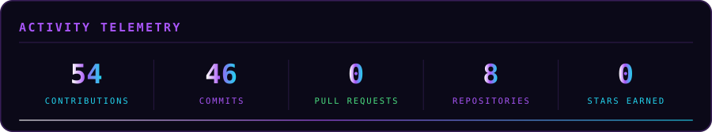
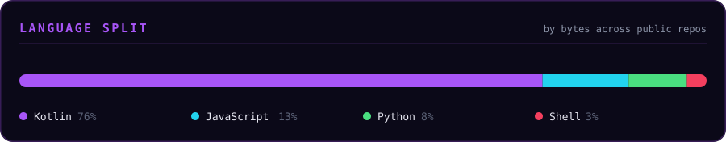
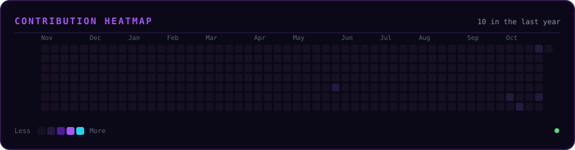

<div align="center">



<br/>


<br/><br/>

[](https://github.com/irfan420x?tab=followers)
[](https://github.com/irfan420x)
[](https://github.com/irfan420x)

</div>


##  &nbsp;whoami

```python
class Irfan:
    """Purple teamer — I break it to prove the gap, then I close it."""

    name       = "Irfan Ahmmed"
    handle     = "irfan420x"
    location   = "Bangladesh 🇧🇩"
    roles      = ["Security Researcher", "Automation Engineer", "Full-Stack Developer"]

    offsec     = ["Web / API pentesting", "Network & wireless", "AD exploitation"]
    defsec     = ["Detection engineering", "Hardening", "Incident response"]
    reversing  = ["Android APK / DEX", "Kernel modules (.ko)", "Ad & bypass patching"]

    platforms  = ["Kali Linux (KDE / Wayland)", "Rooted OnePlus 11 + NetHunter", "Docker"]
    building   = "NOVA OS — my own custom Android ROM, and its entire app suite"
    shipping   = ["NOVA Files v1.18", "NOVA Dialer v1.9", "NOVA Contacts v1.8", "NOVA Gallery v1.8"]

    def philosophy(self) -> str:
        return "Unauthorised means unauthorised. Everything else, I ship."
```


##  &nbsp;NOVA OS

Building my own custom Android ROM — **NOVA OS** — and its whole app suite from scratch, in Kotlin + Jetpack Compose. No Gradle, no shortcuts: a hand-rolled aapt2 / kotlinc build pipeline, and every app audited the way a senior engineer would.

| App | What it does | Version |
|:---|:---|:---:|
| **[NOVA-Files](https://github.com/irfan420x/NOVA-Files)** | Advanced file manager — Recycle Bin, PIN Vault, Storage Analyzer, APK backup | [v1.18](https://github.com/irfan420x/NOVA-Files/releases/tag/v1.18) |
| **[NOVA-Dialer](https://github.com/irfan420x/NOVA-Dialer)** | Dialer with T9 search, dual-SIM calling, Recents & in-call screen | [v1.9](https://github.com/irfan420x/NOVA-Dialer/releases/tag/v1.9) |
| **[NOVA-Contacts](https://github.com/irfan420x/NOVA-Contacts)** | Contacts with duplicate merge, vCard import / export, call history | [v1.8](https://github.com/irfan420x/NOVA-Contacts/releases/tag/v1.8) |
| **[NOVA-Gallery](https://github.com/irfan420x/NOVA-Gallery)** | Gallery with Trash, Memories, search & exact album counts | [v1.8](https://github.com/irfan420x/NOVA-Gallery/releases/tag/v1.8) |


##  &nbsp;Arsenal

<div align="center">

**Offensive**


**Defensive**


**Android / Reversing**


**Build & Ship**


</div>


##  &nbsp;Telemetry

<div align="center">





</div>


##  &nbsp;Contribution Grid

<div align="center">



<picture>
  <source media="(prefers-color-scheme: dark)" srcset="https://cdn.jsdelivr.net/gh/irfan420x/irfan420x@output/github-contribution-grid-snake-dark.svg"/>
  <source media="(prefers-color-scheme: light)" srcset="https://cdn.jsdelivr.net/gh/irfan420x/irfan420x@output/github-contribution-grid-snake.svg"/>
  
</picture>

</div>


##  &nbsp;Flagship Builds

| Project | What it does | Stack |
|:---|:---|:---|
| **[NOVA-Files](https://github.com/irfan420x/NOVA-Files)** | The file manager for NOVA OS — Recycle Bin, Vault, Analyzer, APK backup | `Kotlin` |
| **[NOVA-Dialer](https://github.com/irfan420x/NOVA-Dialer)** | The dialer for NOVA OS — T9 search, dual-SIM, Recents | `Kotlin` |
| **[NOVA-Contacts](https://github.com/irfan420x/NOVA-Contacts)** | The contacts manager for NOVA OS — merge, vCard, call history | `Kotlin` |
| **[NOVA-Gallery](https://github.com/irfan420x/NOVA-Gallery)** | The gallery for NOVA OS — Trash, Memories, search | `Kotlin` |
| **[orion-fca](https://github.com/irfan420x/orion-fca)** | Independent Facebook Messenger client — no third-party FCA code | `JavaScript` |
| **[sherpur](https://github.com/irfan420x/sherpur)** | Sherpur civic service platform — plan, roadmap, data ops | `Docs` |


##  &nbsp;What I Actually Do

<table>
<tr>
<td width="50%" valign="top">

### ⚔️ &nbsp;Offensive
- Web & API penetration testing
- Network / wireless assessment
- Active Directory exploitation
- PoC & exploit development

</td>
<td width="50%" valign="top">

### 🛡️ &nbsp;Defensive
- Detection & log engineering
- System hardening (Linux / Windows)
- Incident response & forensics
- Threat hunting & IOC correlation

</td>
</tr>
<tr>
<td width="50%" valign="top">

### 📱 &nbsp;Android Reversing
- APK / DEX static & dynamic analysis
- Kernel module (.ko) porting
- Ad / license / premium bypass research
- Rooted device tooling (KernelSU, NetHunter)

</td>
<td width="50%" valign="top">

### ⚙️ &nbsp;Automation & AI
- Autonomous agent architectures
- Scraping & data pipelines
- Bot frameworks (Messenger, Telegram)
- Self-hosted infrastructure

</td>
</tr>
</table>


##  &nbsp;Reach Me

<div align="center">

[](mailto:irfan@proton.me)
[](https://github.com/irfan420x)
[](https://irfan.nl8.eu)

<br/>

*"Code is like humor. When you have to explain it, it's bad."*

**Break it. Prove it. Fix it.** ⭐

</div>


