 

  

## Senior full-stack engineer. I build systems, not demos.

I design and ship software end to end — from the OS layer to the UI. Two systems carry most of my work: **Orion**, a local-first OS agent, and **NOVA OS**, a custom Android ROM with its own app suite. Background in security research — purple team: I break it to prove the gap, then I close it.

##  &nbsp;Currently building

### [Orion](https://github.com/irfan420x/orion-agent) — a local-first OS agent
Model-agnostic, Telegram-native. Computer use, vision, voice, and provider switching that keeps the same session alive when one provider runs dry. Go core, built and audited by a two-engineer team.

### [NOVA OS](https://github.com/irfan420x/NOVA-Files) — a custom Android ROM + app suite
My own ROM and its entire app suite, built from scratch in Kotlin + Jetpack Compose — file manager, browser, dialer, contacts, gallery. Hand-rolled build pipeline, no shortcuts.

##  &nbsp;How I engineer

- **Think before building** — data flow, failure modes, edge cases first.
- **Test like a user**, not like the author.
- **Fix the root cause** — never paper over a bug.
- **Verify before delivering** — live proof, not claims.
- **Audit by impact** — data loss first, crashes second, polish last.
- **Finish one thing** before starting the next.

##  &nbsp;Stack

##  &nbsp;Selected work

| Project | What it is |
|:---|:---|
| **[orion-agent](https://github.com/irfan420x/orion-agent)** | Local-first OS agent — model-agnostic, computer use, vision, voice |
| **[NOVA-Files](https://github.com/irfan420x/NOVA-Files)** | File manager for NOVA OS — Recycle Bin, encrypted Vault, Analyzer, APK backup |
| **[NOVA-Browser](https://github.com/irfan420x/NOVA-Browser)** | Browser for NOVA OS — ad blocker, userscripts, Reader mode, Dev Mode |
| **[NOVA-Dialer](https://github.com/irfan420x/NOVA-Dialer)** | Dialer for NOVA OS — T9 search, dual-SIM calling, Recents |
| **[NOVA-Contacts](https://github.com/irfan420x/NOVA-Contacts)** | Contacts for NOVA OS — duplicate merge, vCard, call history |
| **[NOVA-Gallery](https://github.com/irfan420x/NOVA-Gallery)** | Gallery for NOVA OS — Trash, Memories, search |

##  &nbsp;Telemetry

##  &nbsp;Contribution Grid

<picture>
  <source media="(prefers-color-scheme: dark)" srcset="https://cdn.jsdelivr.net/gh/irfan420x/irfan420x@output/github-contribution-grid-snake-dark.svg"/>
  <source media="(prefers-color-scheme: light)" srcset="https://cdn.jsdelivr.net/gh/irfan420x/irfan420x@output/github-contribution-grid-snake.svg"/>
  
</picture>

##  &nbsp;Reach Me

 

*"Code is like humor. When you have to explain it, it's bad."*

**Break it. Prove it. Fix it.** ⭐

